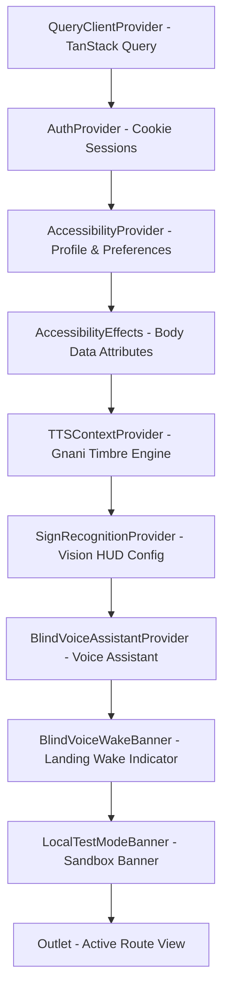
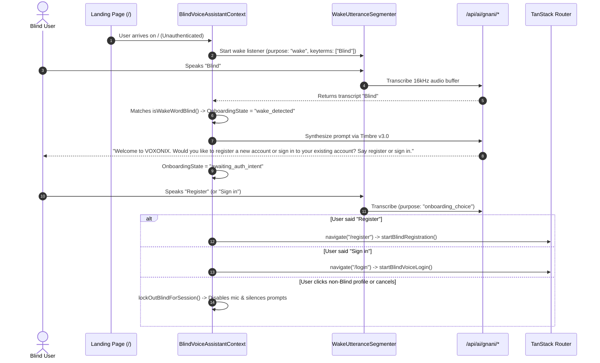
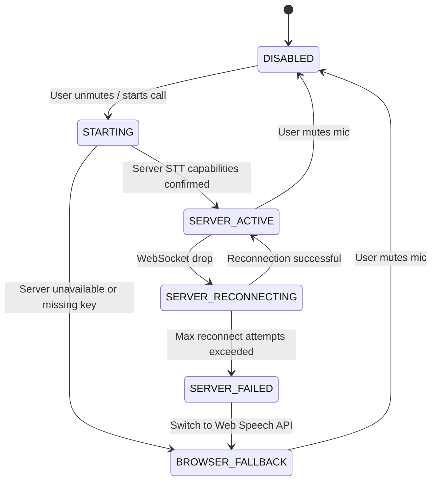
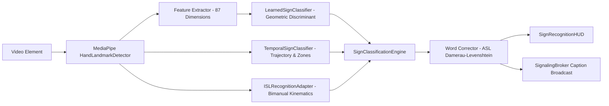

# VOXONIX ✕ AI

> **"Two people should be able to have one conversation even when they do not communicate in the same way."**
>
> A local-first, privacy-focused real-time inclusive communication platform built with **TanStack Start**, **React 19**, **TypeScript 5.8+**, **Vite 7**, **WebRTC**, **Gnani Prisma v3.0 / Timbre v3.0**, **Deepgram Nova-3**, and **MediaPipe Hands**. It unifies **Deaf / Hard of Hearing**, **Non-speaking**, **Blind / Low Vision**, and **Hearing & Speaking (Standard)** participants in shared 1-to-1 multimodal communication.

---

## Table of Contents

1. [Executive Summary & Golden Luxe Design Philosophy](#1-executive-summary--golden-luxe-design-philosophy)
2. [Complete Provider Tree, Routing & Full-Stack Lifecycle](#2-complete-provider-tree-routing--full-stack-lifecycle)
3. [Communication Profiles & Strict Capability Matrix](#3-communication-profiles--strict-capability-matrix)
4. [Blind Voice Assistant, Hands-Free Onboarding, Audio Worklet & Auth State Machines](#4-blind-voice-assistant-hands-free-onboarding-audio-worklet--auth-state-machines)
5. [Real-Time 1-to-1 WebRTC Video Calling, Signaling Gateway & Live Captions](#5-real-time-1-to-1-webrtc-video-calling-signaling-gateway--live-captions)
6. [Computer Vision & Sign Language Recognition Subsystem](#6-computer-vision--sign-language-recognition-subsystem)
7. [Speech Output Engine, AAC Board, Braille & Screen Reader Subsystems](#7-speech-output-engine-aac-board-braille--screen-reader-subsystems)
8. [Security, Persistence, Session Lifecycle & Cryptography](#8-security-persistence-session-lifecycle--cryptography)
9. [Complete Route Catalog, Server API Endpoints & Keyboard Shortcuts](#9-complete-route-catalog-server-api-endpoints--keyboard-shortcuts)
10. [Exhaustive Tracked File-by-File Directory Map](#10-exhaustive-tracked-file-by-file-directory-map)
11. [Environment Setup, Scripts & Workflows](#11-environment-setup-scripts--workflows)
12. [Technical Scope & Honest Engineering Limitations](#12-technical-scope--honest-engineering-limitations)

---

## 1. Executive Summary & Golden Luxe Design Philosophy

VOXONIX bridges human communication barriers across four distinct modalities without forcing any participant to adopt a modality that does not suit their abilities:

- **Deaf / Hard of Hearing**: Live real-time speech captions (Deepgram Nova-3 / Web Speech), computer vision sign language recognition (MediaPipe 3D hand tracking, ASL static fingerspelling, temporal sign gestures, and two-handed Indian Sign Language), gesture-safe video framing, visual notifications, and persistent transcripts.
- **Non-speaking**: Augmentative and Alternative Communication (AAC) board with 38 categorized phrases, custom phrase builder, favorite phrase pins, phrase composer, type-to-speak synthesis via Gnani Timbre v3.0, and silent caption broadcasting.
- **Blind / Low Vision**: Complete hands-free voice onboarding ("Blind" wake-word activation), conversational Register / Sign In decision fork, ordinary English letter-by-letter name spelling, email dictation, chunked password capture with case and symbol prefixes, deterministic voice command navigation, dual-channel screen reader announcements (`aria-live="polite"` and `assertive`), high-contrast golden luxe styling, and Unicode Grade 1 Braille transcription.
- **Hearing & Speaking (Standard)**: High-definition 1-to-1 WebRTC audio/video calling, real-time live subtitle display, typed in-call chat, and cross-modality communication guides.

### Local-First, Zero-BaaS Architecture

VOXONIX operates entirely on a local-first application boundary:

- **No Third-Party BaaS**: Zero dependency on Firebase, Supabase, AWS Amplify, Clerk, or hosted databases.
- **Local Atomic Persistence**: All users and sessions are stored in `data/voxonix-db.json` (with atomic file writing, automatic schema migrations, and mirrored backup recovery).
- **Server-Proxied AI Credentials**: Client browser bundles never receive or execute raw API keys. All speech recognition (Gnani Prisma v3.0), speech synthesis (Gnani Timbre v3.0), and call transcription (Deepgram Nova-3) pass through authenticated, rate-limited backend endpoints.
- **Zero LLMs in Critical Loops**: Onboarding navigation, voice command interpretation, alphabet decoding, email parsing, password assembly, and sign language recognition use deterministic parsers and finite state machines, ensuring complete predictability and zero hallucinated form inputs.

### Golden Luxe Design System & Visual Tokens

The user interface uses the **"Golden Luxe"** palette defined in `src/styles.css`:

```css
/* Golden Luxe Palette */
--cream: #ede7c7; /* Primary background & warm card surface */
--cream-deep: #e2d9b0; /* Subdued borders & hover surfaces */
--crimson: #8b0000; /* Primary brand accent & active states */
--wine: #5b0202; /* Deep secondary accent & headings */
--noir: #200e01; /* High-contrast ink text & structural elements */
```

- **Typography**: Display typography is rendered in `"Cormorant Garamond"` (ui-serif, Georgia), while interface controls, captions, and body text use `"Inter"` (ui-sans-serif, system-ui).
- **Interactive Background (`src/components/InteractiveBackground.tsx`)**: Editorial textured paper background with cursor-following radial ink gradients and CSS drift animations (`animate-drift-a`, `animate-drift-b`), disabled automatically when reduced motion is requested.
- **Document-Boundary Accessibility Attributes**: The `AccessibilityEffects` component in `src/routes/__root.tsx` syncs preferences directly to `<body>` attributes:
  - `data-high-contrast="true"`: Applies `filter: contrast(1.2)` globally.
  - `data-large-controls="true"`: Enforces `min-height: 2.75rem` on all buttons, inputs, selects, and textareas, and enlarges subtitle overlays to `1.125rem` (18px) with `line-height: 1.5`.
  - `data-reduced-motion="true"`: Forces `animation-duration: 0.01ms !important`, `transition-duration: 0.01ms !important`, and `scroll-behavior: auto !important` across all DOM nodes.

---

## 2. Complete Provider Tree, Routing & Full-Stack Lifecycle

### Server Integration Lifecycle (`vite.config.ts`, `src/server.ts`, `src/start.ts`)

VOXONIX runs as a full-stack **TanStack Start** application with two server operating modes:

1. **Development & Preview Mode (`vite.config.ts`)**:
   - Custom Vite middleware plugin `signalingPlugin()` binds directly to Vite's development Connect HTTP server.
   - Mounts `/api/auth/*` handlers via `authMiddleware` (`src/server/auth-api.ts`).
   - Mounts `/api/ai/gnani/*` handlers via `gnaniMiddleware` (`src/server/gnani-service.ts`).
   - Intercepts HTTP `Upgrade` requests to mount WebSocket room signaling on `/ws` (`src/server/signaling-server.ts`).
   - Mounts WebSocket streaming STT proxying on `/ws/gnani-stt` (`src/server/gnani-service.ts`).
   - Enforces security blocking rules: rejects any requests attempting to access `/data`, `*voxonix-db*`, `*.json`, or `*.env*` with HTTP `403 Forbidden`.
2. **Production Fetch Entry (`src/server.ts`)**:
   - Standard Web Fetch Request handler for production Node.js / Bun / Edge deployment.
   - Inspects incoming URLs: immediately blocks protected database paths (`/data`, `voxonix-db`, `*.json`, `*.env*`) with HTTP `403`.
   - Routes `/api/auth/*` to `handleAuthFetchRequest(request)`.
   - Routes `/api/ai/gnani/*` to `handleGnaniFetchRequest(request)`.
   - Returns HTTP `410 Gone` for deprecated legacy endpoints (`/api/ai/stt`, `/api/ai/tts`).
   - Passes all remaining SSR page requests to TanStack Start's default fetch handler.
3. **Application Error Boundary Middleware (`src/start.ts`, `src/lib/error-capture.ts`, `src/lib/error-page.ts`)**:
   - `createStart({ requestMiddleware: [errorMiddleware] })`: intercepts unhandled server errors.
   - `consumeLastCapturedError()` recovers the original error stack if swallowed by the SSR runtime.
   - Renders a clean standalone HTML fallback (`renderErrorPage()`) returning HTTP `500`.

### Client Context Provider Hierarchy (`src/routes/__root.tsx`)

Every route in VOXONIX is wrapped inside the following strictly ordered React Context hierarchy:



1. **`QueryClientProvider`** (`@tanstack/react-query`): Provides query caching for server state.
2. **`AuthProvider`** (`src/context/auth-context.tsx`): Hydrates user session from `/api/auth/session` via `getEffectiveSession()`. Provides `signUp`, `signIn`, `signOut`, `signOutAll`, and `resetPassword`.
3. **`AccessibilityProvider`** (`src/context/accessibility-context.tsx`): Manages the user's active `AccessibilityProfile` and `CommunicationPreferences`. Synchronizes authoritative profile state from `user.user_metadata.accessibility_profile`, falling back to `localStorage` keys `voxonix.accessibilityProfile` and `voxonix.communicationPreferences` when unauthenticated.
4. **`AccessibilityEffects`**: Side-effect component applying `data-high-contrast`, `data-large-controls`, and `data-reduced-motion` to `document.body`.
5. **`TTSContextProvider`** (`src/context/tts-context.tsx`): Manages singleton `GnaniTTSProvider`, holds active voice preferences (voiceId, rate, pitch, volume, speaker vs headphone mode), and controls speech synthesis.
6. **`SignRecognitionProvider`** (`src/context/sign-recognition-context.tsx`): Manages computer vision HUD configuration (`SignRecognitionConfig`), linking effective activation state to `preferences.signRecognitionEnabled`.
7. **`BlindVoiceAssistantProvider`** (`src/context/blind-voice-assistant-context.tsx`): Orchestrates landing wake-word detection, conversational onboarding choices, Blind registration/login flows, ordinary letter dictation, password capture, and hands-free route navigation.
8. **Root Banners & Outlet**:
   - `BlindVoiceWakeBanner`: Visual indicator on `/` notifying users that the hands-free voice assistant is active.
   - `LocalTestModeBanner`: Sticky sandbox banner displayed only when `VITE_LOCAL_TEST_MODE=true`.
   - `<Outlet />`: Renders the active TanStack Router route.

---

## 3. Communication Profiles & Strict Capability Matrix

VOXONIX defines four primary communication profiles in `src/lib/capabilities.ts`. Every registered user is assigned exactly one primary profile stored in `user.user_metadata.accessibility_profile`:

```typescript
export type PrimaryProfile = "deaf" | "non-speaking" | "blind" | "standard";
```

### Profile Capabilities Registry (`PROFILE_CAPABILITIES`)

To prevent feature leakage and cognitive overload, views enforce capability authorization via `hasCapability(profile, capability)` and `assertCapability(profile, capability)`:

| Primary Profile                        | Authorized Capabilities (`PROFILE_CAPABILITIES`)                                                                                                                          | Segregated Dashboard View                               |
| :------------------------------------- | :------------------------------------------------------------------------------------------------------------------------------------------------------------------------ | :------------------------------------------------------ |
| **`deaf`**<br>(Deaf / Hard of Hearing) | `live-captions`<br>`persistent-transcript`<br>`typed-messaging`<br>`sign-recognition`<br>`isl-reference`<br>`gesture-safe-framing`<br>`visual-notifications`              | `DeafDashboardView` (`src/routes/dashboard.tsx`)        |
| **`non-speaking`**<br>(Non-speaking)   | `aac-board`<br>`phrase-favorites`<br>`custom-phrases`<br>`text-compose`<br>`type-to-speech`<br>`silent-send`                                                              | `NonSpeakingDashboardView` (`src/routes/dashboard.tsx`) |
| **`blind`**<br>(Blind / Low Vision)    | `screen-reader-mode`<br>`voice-guided-navigation`<br>`speech-input`<br>`spoken-notifications`<br>`accessible-transcript`<br>`text-scaling`<br>`braille-compatible-output` | `BlindDashboardView` (`src/routes/dashboard.tsx`)       |
| **`standard`**<br>(Hearing & Speaking) | `audio-video-call`<br>`basic-chat`<br>`room-controls`<br>`participant-information`                                                                                        | `StandardDashboardView` (`src/routes/dashboard.tsx`)    |

### Default Preferences Preset Table (`DEFAULT_PREFERENCES_BY_PROFILE`)

Preferences defined in `src/lib/accessibility.ts` are initialized according to the user's profile:

| Preference Key           | `blind` | `deaf`  |        `deafblind` (compat)        | `non-speaking` | `standard` |
| :----------------------- | :-----: | :-----: | :--------------------------------: | :------------: | :--------: |
| `captionsEnabled`        | `true`  | `true`  |               `true`               |     `true`     |   `true`   |
| `speechOutputEnabled`    | `true`  | `false` | **`false`** _(never assume audio)_ |     `true`     |  `false`   |
| `typeToSpeakEnabled`     | `false` | `false` |               `true`               |     `true`     |  `false`   |
| `signRecognitionEnabled` | `false` | `true`  |              `false`               |    `false`     |  `false`   |
| `gestureSafeFraming`     | `false` | `true`  |              `false`               |    `false`     |  `false`   |
| `highContrast`           | `true`  | `false` |               `true`               |    `false`     |  `false`   |
| `largeControls`          | `true`  | `false` |               `true`               |    `false`     |  `false`   |
| `reducedMotion`          | `false` | `false` |               `true`               |    `false`     |  `false`   |
| `brailleOutputEnabled`   | `false` | `false` |               `true`               |    `false`     |  `false`   |
| `persistentTranscript`   | `false` | `false` |               `true`               |    `false`     |  `false`   |

---

## 4. Blind Voice Assistant, Hands-Free Onboarding, Audio Worklet & Auth State Machines

The Blind voice experience allows a completely non-sighted user to open VOXONIX, register an account, sign in, and navigate calls without touching a keyboard or mouse. It runs entirely on **Gnani Prisma v3.0** (STT) and **Gnani Timbre v3.0** (TTS) with **zero browser Web Speech synthesis** and **zero third-party LLMs**.

### Local Audio Capture Worklet (`src/lib/accessibility/local-audio-capture.ts`)

Microphone audio is captured cleanly off the main thread:

- **`createLocalAudioCapturePipeline`**: Initializes an inline `AudioWorkletNode` running an off-thread RMS gate. If `AudioWorklet` is unsupported, it falls back to a `ScriptProcessorNode`.
- **Pre-Roll Ring Buffer**: Maintains a continuous `~450 ms` pre-roll ring buffer so speech onset transients are never clipped.
- **Trailing Hangover**: Holds speech active for `~2.0 s` of silence before gate closure.
- **DC Blocker**: Filters out microphone DC bias using a 1-pole high-pass filter at `~55 Hz` (`fc = 55.0 / sampleRate`).
- **Resampling Pipeline (`downsampleTo16kHz`)**: Uses a Hann-windowed sinc anti-aliasing interpolation algorithm to resample native hardware rates (44.1 kHz / 48 kHz) down to **16,000 Hz Float32 and 16-bit linear PCM**.

### Noise-Floor VAD & Credit Protection (`src/lib/accessibility/blind-voice-wake.ts`)

The `WakeUtteranceSegmenter` manages speech segmentation and prevents runaway API credit burn:

- **Adaptive Noise-Floor VAD**: Initial baseline speech RMS threshold `0.008`. Dynamically adapts to ambient background room noise.
- **Dynamic Hang Intervals**:
  - `450 ms`: Wake-word detection (`"Blind"`).
  - `680 ms`: Voice commands and onboarding choice (`"register"`, `"sign in"`).
  - `850 ms`: Natural name dictation.
  - `1050 ms`: Spoken email dictation.
  - `1350 ms`: Ordinary letter spelling and chunked password dictation.
- **Quiet-Utterance Gain Boost (`normalizeQuietUtteranceAudio`)**: Multiplies quiet utterances by up to `3.5x` gain if speech RMS falls below `0.05` to ensure consistent Gnani Prisma transcription.
- **Acoustic Deduplication (`hashAudioSamples`)**: Uses 32-bit FNV-1a hashing on downsampled audio samples. Discards identical acoustic fingerprints received within a 5-second window.
- **Echo Fade Guards**: Discards microphone buffers during and immediately following TTS playback (`250 ms` during login submit, `450 ms` during active form filling, `600 ms` during onboarding).
- **Zero Automatic Retries**: If Gnani returns an empty transcript or network failure, VOXONIX **never automatically retries** the request, protecting user API credits.

### Finite State Machine Enums

State flow is governed by explicit TypeScript enums:

```typescript
export type OnboardingState =
  | "idle"
  | "wake_detected"
  | "awaiting_auth_intent"
  | "transitioning_register"
  | "transitioning_login";

export type WakeStatus =
  | "idle"
  | "requesting_permission"
  | "listening"
  | "permission_denied"
  | "device_unavailable"
  | "locked_out";

export type VoiceState =
  | "disabled"
  | "checking_permission"
  | "requesting_permission"
  | "listening"
  | "processing"
  | "speaking"
  | "paused"
  | "permission_denied"
  | "device_unavailable"
  | "error";

export type RegistrationFieldPhase =
  | "idle"
  | "listening_name"
  | "spelling_first_name"
  | "spelling_surname"
  | "confirming_name"
  | "listening_email"
  | "spelling_email"
  | "confirming_email"
  | "listening_password"
  | "confirming_password"
  | "listening_confirm_password"
  | "confirming_submit";

export type LoginFieldPhase =
  | "idle"
  | "listening_login_email"
  | "spelling_login_email"
  | "confirming_login_email"
  | "listening_login_password"
  | "confirming_login_submit"
  | "submitting_login";
```

### Landing Wake-Word & Conversational Onboarding Flow



### Ordinary Spoken Alphabet Decoder (`src/lib/accessibility/registration-voice-extractor.ts`)

Users spell names and emails using natural spoken letters without requiring NATO codewords:

- **`ORDINARY_LETTER_TOKEN_MAP`**: Maps natural spoken letters to their canonical single-character equivalents. Handles phonetic variations:
  - `A`: `"a"`, `"ay"`
  - `B`: `"b"`, `"bee"`
  - `C`: `"c"`, `"see"`, `"sea"`
  - `N`: `"n"`, `"en"`, `"enn"`, `"the letter n"`, `"letter n"` (strict normalization avoids mapping unrelated words like `"and"`)
  - `Z`: `"z"`, `"zee"`, `"zed"`
- **Space & Boundary Detection**: Recognizes `"space"`, `"next name"`, or `"surname"` to transition cleanly from first name (`spelling_first_name`) to surname (`spelling_surname`).
- **Editing Commands**: Recognizes `"backspace"` (deletes last character), `"clear"` (clears current field), `"skip"` (advances field), `"replace first name"`, and `"replace surname"`.
- **Single-Letter Preservation**: If a user dictates `R I S H A N` and the system recognizes `R I S H A` but fails on the last character, the first five characters are **strictly preserved**, and the assistant prompts: _"I recognised R, I, S, H, A. Please repeat the last letter."_

### Spoken Email Dictation & Domain Normalizer

- **`parseSpelledEmailChunk` & `normalizeSpokenEmail`**:
  - Accumulates alphanumeric local-part characters.
  - Converts spoken digits (`"zero"` through `"nine"`) into `'0'`–`'9'`.
  - Translates spoken separators: `"at"`, `"at sign"`, `"at the rate"` -> `'@'`.
  - Maps common spoken domain phrases: `"gmail dot com"`, `"yahoo dot com"`, `"outlook dot com"`, `"hotmail dot com"`, `"icloud dot com"`.
  - Supports field corrections: `"change username"`, `"change domain"`, `"change email"`.

### Privacy-Preserving Password Dictation

- **`parseSpelledPassword`**:
  - Accepts chunked password dictation without length limits.
  - Case prefixes: `"capital"` or `"uppercase"` produces uppercase; `"small"` or `"lowercase"` produces lowercase; unprefixed letters default to lowercase.
  - Spoken digits: `"zero"` through `"nine"` -> `'0'`–`'9'`.
  - Named symbols: `"at"` (`@`), `"dot"` / `"period"` (`.`), `"underscore"` (`_`), `"dash"` / `"hyphen"` / `"minus"` (`-`), `"exclamation"` / `"bang"` (`!`), `"hash"` / `"hashtag"` / `"pound"` (`#`), `"dollar"` (`$`), `"percent"` (`%`), `"caret"` / `"hat"` (`^`), `"ampersand"` / `"and"` (`&`), `"asterisk"` / `"star"` (`*`), `"plus"` (`+`), `"equals"` (`=`), `"question"` (`?`), `"slash"` / `"forward slash"` (`/`), `"backslash"` (`\`), `"colon"` (`:`), `"semicolon"` (`;`), `"tilde"` (`~`), `"comma"` (`,`).
  - **Zero Password Exposure**: Form inputs use `<input type="password">`. `lastTranscript` is set to `null`. The backend omits `keyterms` and `speaker_names` from STT requests. Passwords are **never spoken aloud by TTS**, cached in plain text, or logged to the console.

### Blind Registration Flow (5 Steps)

1. **Step 1: Profile Selection**: User confirms `"blind"` profile.
2. **Step 2: Full Name Spelling**: Dictate first name, say `"space"`, dictate surname. Assistant reads back full name and asks for confirmation (`"yes"` or `"confirm"`).
3. **Step 3: Email Dictation**: Dictate email username and domain. Assistant reads back the parsed address and awaits confirmation.
4. **Step 4: Password Dictation**: Dictate password chunks, say `"done"`, re-dictate password to verify match.
5. **Step 5: Review & Submit**: Summary readback. User says `"submit"` or `"register"` to finalize `/api/auth/register`.

### Blind Sign In Flow (3 Steps) & Uninterrupted Announcement

1. **Step 1: Email Entry (`spelling_login_email` -> `confirming_login_email`)**: User spells email. Assistant confirms readback.
2. **Step 2: Password Entry (`listening_login_password`)**: User dictates password chunks, then says `"done"` or `"next"`. Password input blurs to `#btn-login-submit`.
3. **Step 3: Confirmation & Submit (`confirming_login_submit` -> `submitting_login`)**:
   - Focus is pinned to post-password confirmation commands (`purpose: "login_command"`, keyterms: `["sign in", "sign in now", "log in", "submit", "add more", "change password", "change email"]`).
   - Command matching via `isUnambiguousLoginSubmitCommand` and `interpretVoiceCommand`.
   - Single ~20-second inactivity confirmation timer (`LOGIN_CONFIRM_INACTIVITY_MS = 20_000`) with at most 1 automatic reprompt.
   - On valid submission, `login.tsx` delays navigation via `isDelayingRedirectForSpeechRef` while `completeBlindLoginSuccess()` stops microphone capture, plays **one single uninterrupted announcement** via Gnani Timbre (_"Sign in successful. Welcome to VOXONIX. Your dashboard is opening now."_), awaits actual audio `onended` completion, and then navigates to `/dashboard`.

### Cross-Component Custom DOM Event Bus (`voxonix:*`)

The voice assistant communicates with form components and call views via standard `window` events:

| Event Name                         | Direction              | Payload / Purpose                                                                                                                                                                                                                    |
| :--------------------------------- | :--------------------- | :----------------------------------------------------------------------------------------------------------------------------------------------------------------------------------------------------------------------------------- |
| `voxonix:voice-input`              | Assistant -> Forms     | Dispatches field actions: `candidate_name`, `fill_name`, `candidate_email`, `fill_email`, `fill_voice_password`, `login_password_ready`, `submit`, `submit_login`, `start_again`, `continue_step`, `reset_email`, `reset_passwords`. |
| `voxonix:sync-reg-phase`           | Forms -> Assistant     | Syncs registration step state back into the assistant context.                                                                                                                                                                       |
| `voxonix:sync-login-phase`         | Forms -> Assistant     | Syncs login step state back into the assistant context.                                                                                                                                                                              |
| `voxonix:request-spelling`         | Forms -> Assistant     | Forces assistant into spelling mode for a target field.                                                                                                                                                                              |
| `voxonix:register-reset-passwords` | Assistant -> Register  | Clears masked registration password input values.                                                                                                                                                                                    |
| `voxonix:login-clear-password`     | Assistant -> Login     | Clears masked login password input value.                                                                                                                                                                                            |
| `voxonix:login-auth-result`        | Login -> Assistant     | Returns authentication result (`success: true/false`, status `401`/`429`/`5xx`) to trigger vocal recovery prompts.                                                                                                                   |
| `voxonix:dashboard-action`         | Assistant -> Dashboard | Triggers `start_call` or `join_call` with parsed 6-character room codes.                                                                                                                                                             |
| `voxonix:call-action`              | Assistant -> Room      | Controls call actions: `mute_mic`, `unmute_mic`, `toggle_camera`, `leave_call`, `read_messages`.                                                                                                                                     |

---

## 5. Real-Time 1-to-1 WebRTC Video Calling, Signaling Gateway & Live Captions

VOXONIX implements full-duplex WebRTC 1-to-1 audio and video communication with server-mediated signaling and live caption streaming.

### Strict 1-to-1 Topology Invariant (`MAX_PARTICIPANTS = 2`)

```typescript
// src/lib/webrtc/config.ts
export const MAX_PARTICIPANTS = 2;
```

The signaling server enforces `MAX_PARTICIPANTS = 2`. If a third peer attempts to join an active room, the server rejects the connection with a `room-full` message. This invariant guarantees that UI views, gesture overlays, and caption streams remain strictly paired without layout breakage.

### WebSocket Signaling Protocol (`src/lib/webrtc/signaling-protocol.ts`)

Signaling runs over WebSocket at `/ws`. Messages conform to the `SignalMessage` tagged union:

```typescript
export type SignalMessage =
  | { type: "join"; roomId: string; peerId: string; displayName?: string; authToken?: string }
  | { type: "leave" }
  | {
      type: "joined";
      roomId: string;
      peerId: string;
      peersCount: number;
      existingPeers: RemotePeerInfo[];
      displayName?: string;
    }
  | { type: "peer-joined"; peerId: string; displayName?: string; peersCount: number }
  | { type: "offer"; from: string; to: string; sdp: RTCSessionDescriptionInit }
  | { type: "answer"; from: string; to: string; sdp: RTCSessionDescriptionInit }
  | { type: "ice-candidate"; from: string; to: string; candidate: RTCIceCandidateInit }
  | { type: "media-state"; from: string; to?: string; videoEnabled: boolean; audioEnabled: boolean }
  | { type: "caption"; caption: CaptionPayload }
  | {
      type: "stt-capabilities";
      available: boolean;
      provider: "deepgram" | "mock" | "browser-fallback";
      model?: string;
    }
  | { type: "stt-start"; mimeType: string; language?: string }
  | { type: "stt-stop" }
  | { type: "stt-state"; state: "active" | "reconnecting" | "failed" | "closed"; message?: string }
  | {
      type: "stt-audio-chunk";
      chunkIndex: number;
      data: string;
      durationMs?: number;
      timestamp: number;
    }
  | { type: "peer-left"; peerId: string; peersCount: number }
  | { type: "room-full"; message: string }
  | { type: "error"; message: string };
```

### Peer Connection Architecture (`src/lib/webrtc/peer.ts`)

`PeerConnectionManager` manages the underlying `RTCPeerConnection` with separate negotiation logic for initiators and responders:

- **Initiator Flow**:
  1. Calls `addTracks(videoTrack, audioTrack)`: attaches local tracks to create transceivers with distinct Media IDs (MIDs).
  2. Calls `createOffer()`: generates SDP offer matching transceiver MIDs.
  3. Sends `offer` message through the signaling broker.
- **Responder Flow**:
  1. Receives `offer` message.
  2. Calls `handleOfferWithTracks(offer, videoTrack, audioTrack)`.
  3. Executes `pc.setRemoteDescription(offer)` **first**: this creates transceivers matching the initiator's MIDs exactly.
  4. Calls `replaceTrack()` on the matched senders to inject local media into the established transceivers.
  5. Calls `createAnswer()` and `setLocalDescription(answer)`.
- **In-Place Track Replacement (`syncTracks`)**: When toggling cameras or microphones, `syncTracks()` calls `RTCRtpSender.replaceTrack()` without triggering SDP renegotiation.
- **Single Stable `remoteStream`**: Remote tracks are added into a single pre-allocated `MediaStream` instance (`this.remoteStream.addTrack(t)`), preventing video element unmounting.
- **Pending ICE Queue**: Stores incoming ICE candidates that arrive before `setRemoteDescription` finishes, flushing them sequentially once the description is set.

### Signaling Broker (`src/lib/webrtc/signaling.ts`)

`SignalingBroker` encapsulates the WebSocket transport:

- **URL Resolution**: Connects to `VITE_SIGNALING_URL` if configured, or defaults to same-origin `ws://${window.location.host}/ws` (or `wss://` on HTTPS).
- **Subprotocol Token Authentication**: Passes session tokens via `Sec-WebSocket-Protocol: ["voxonix-auth", encodeURIComponent(authToken)]`, keeping tokens out of browser URL query logs.
- **Multi-Listener Support**: Allows multiple UI components to subscribe to captions (`addCaptionListener`), STT capabilities (`addSTTCapabilitiesListener`), and STT states (`addSTTStateListener`) independently.
- **Auto-Reconnection**: Reconnects automatically using exponential backoff unless explicitly closed via `disconnect()`.

### Live Speech-to-Text & Fallback State Machine



- **Deepgram Nova-3 Streaming (`src/server/stt-manager.ts`)**: When `DEEPGRAM_API_KEY` is configured, client microphone chunks are base64-encoded and relayed via `/ws` to Deepgram's streaming API (`model=nova-3`). Interim transcripts are aggregated until `is_final` or `speech_final` completes the sentence.
- **Authoritative Server Caption Stamping**: On receiving a caption, the signaling server overrides `speakerUserId`, `serverReceivedAt`, and `serverSentAt` to prevent client spoofing.
- **Browser Fallback (`src/lib/stt/browser-stt-provider.ts`)**: If Deepgram is not configured or fails, the state machine falls back to the browser's native `webkitSpeechRecognition` / `SpeechRecognition` engine.
- **Deterministic Conversation Timeline (`src/lib/communication/event-store.ts`)**: `upsertCommunicationEvent` updates interim captions in-place by `utteranceId`, preventing interim transcripts from overwriting finalized captions, and maintains a 50-event FIFO timeline.

---

## 6. Computer Vision & Sign Language Recognition Subsystem

VOXONIX includes an in-browser computer vision pipeline for sign language fingerspelling and gesture recognition.



### MediaPipe Hand Landmark Detector (`src/lib/vision/hand-landmark-detector.ts`)

- **Model Execution**: Uses `@mediapipe/tasks-vision` (`HandLandmarker`) running in `VIDEO` mode with 2-hand tracking (`numHands: 2`).
- **Delegate Fallback**: Attempts `GPU` acceleration first; on WebGL failure, falls back automatically to `CPU`.
- **Monotonic Timestamps**: Guarantees strictly increasing timestamp values (`frameTime = Math.max(timestamp, lastProcessedTimestamp + 1)`) required by MediaPipe's video mode.
- **Bimanual Observation Extraction**: Computes relative spatial metrics when two hands are detected:
  - `interWristDistance`: Euclidean distance between wrists.
  - `relativeElevation`: Vertical displacement between wrists (`rw.y - lw.y`).
  - `isSymmetricMovement`: Flags symmetric bimanual movement when `Math.abs(rw.y - lw.y) < 0.08`.

### 87-Dimensional Feature Extractor (`src/lib/vision/feature-extractor.ts`)

Converts 21 MediaPipe 3D coordinates into a scale- and translation-invariant normalized feature vector:

1. **Palm Scale Baseline**: Distance between wrist (0) and middle MCP (9).
2. **Wrist Relative Vectors (60 features)**: 20 normalized 3D vectors from wrist to landmarks 1..20.
3. **Fingertip to Wrist Distances (5 features)**: Euclidean distance from thumb (4), index (8), middle (12), ring (16), and pinky (20) to wrist.
4. **Fingertip to MCP Curl Distances (5 features)**: Euclidean distance between each tip and its corresponding MCP base joint.
5. **Adjacent Fingertip Spreads (4 features)**: Distances between adjacent fingertips (4–8, 8–12, 12–16, 16–20).
6. **Joint Angle Cosines (8 features)**: Cosine of bone segment angles across PIP and MCP joints for all five fingers.
7. **Palm Span Ratio (1 feature)**: Ratio of distance between pinky MCP (17) and index MCP (5) relative to palm scale.

### Static Landmark Classifier (`src/lib/vision/learned-sign-classifier.ts`)

- **Rule-Based Discriminant Scorer**: Evaluates hand-crafted geometric rules, curl factors, and joint angles into class logits, normalized using Softmax.
- **Supported Classes**: 24 static letters (`A`–`I`, `K`–`Y`; dynamic signs `J` and `Z` are handled temporally), `Thumbs Up`, `Open Palm`, and `None`.
- **Rejection Gating**: Enforces minimum confidence threshold (`minConfidenceThreshold = 0.55`) and top-to-second class margin threshold (`minMarginThreshold = 0.15`).
- **Vocabulary Tiering**: Gated strictly behind the `all-dev` tier in `SignClassificationEngine`.

### Temporal Sign Classifier (`src/lib/vision/temporal-sign-classifier.ts`)

- **Spatial Anchor Zones (`SpatialAnchorDetector`)**:
  - `TEMPLE_UPPER`: High lateral head space (`HELLO` anchor).
  - `CHIN_FACE`: Mouth and chin proximity (`THANK YOU` anchor).
  - `MID_CHEST`: Standard signing space (`YES`, `NO`, `J`, `Z`).
  - `LOWER_REST`: Hands resting below signing space.
  - `BIMANUAL_SPACE`: Coordinated two-handed space.
- **Sequence Boundary State Machine (`SequenceBoundaryStateMachine`)**: Transitions through `IDLE` -> `PREPARATION` -> `NUCLEUS` -> `HOLD` -> `RECOVERY`, tracking kinetic energy and velocity thresholds.
- **Dynamic Letter Trajectories**: Tracks pinky trajectory buffer for `'J'` and index trajectory buffer for `'Z'`.

### Indian Sign Language (ISL) Adapter (`src/lib/vision/isl/isl-adapter.ts`)

- **Bimanual Kinematics**:
  - Single-handed: `good` (Thumbs Up with curled fingers), `bad` (Downward palm).
  - Two-handed (Bimanual): `Letter A` (Index touching thumb tip), `Letter B` (Two touching loops), `today` (Both flat palms facing upward held side by side), `happy` (Both open hands moving near chest).
- **Temporal Stability**: Enforces `400 ms` hold threshold and `1200 ms` cooldown to prevent re-triggering.
- **Transparency**: Every recognized sign is flagged with `isExperimental: true` and `backend: "local-mediapipe-temporal"`.

### Non-Destructive Word Suggestion & Jitter Normalizer (`src/lib/vision/word-corrector.ts`)

- **"User Input is King"**: Raw signed letters are **never silently overwritten**. Suggestions are displayed as optional chips that require user confirmation to apply.
- **Stutter Run Collapsing (`normalizeStutterRuns`)**: Collapses sensor jitter runs of 3+ identical consecutive characters down to 2, strictly preserving natural English double letters (`HELLO`, `BOOK`, `APPLE`).
- **ASL-Weighted Damerau-Levenshtein Distance**: Discounted substitution cost (`0.5`) for 8 known visual confusion pairs:
  - `[U, V]`, `[O, C]`, `[A, E]`, `[A, S]`, `[D, I]`, `[K, P]`, `[B, D]`, `[M, N]`.
  - Transposition cost: `0.8`.
  - For words with 4 or fewer letters, edit distance is restricted to `0.5` to prevent miscorrecting short names or acronyms.
- **Abbreviation Expansions**: 18 conversational expansions (`THX` -> `THANKS`, `TY` -> `THANK YOU`, `PLS` -> `PLEASE`, etc.).

### Benchmark & Stress Testing Suite (`src/lib/vision/benchmark.ts`)

Contains a 2,400+ line automated evaluation suite:

- **Synthetic Landmark Generator (`createSyntheticLandmarks`)**: Generates canonical 21-landmark coordinates with configurable palm scale, finger length modifiers, Gaussian noise, and rotation angles.
- **10 Hard Negative Types**: `casual_waving`, `chin_scratch`, `adjust_glasses`, `point_screen`, `reach_camera`, `conversational_gesticulation`, `random_drift`, `typing_keyboard`, `rubbing_hands`, `clapping`.
- **Metrics**: Evaluates letter accuracy, ROC threshold calibration, false event rate (FER) per hour of video call, bimanual coordination, and ablation testing.

---

## 7. Speech Output Engine, AAC Board, Braille & Screen Reader Subsystems

### Preemptive Speech Output Engine (`src/lib/tts/speech-output-engine.ts`)

- **Priority Queue**: Higher-priority speech (e.g. user-typed AAC messages) preempts lower-priority items (incoming captions) when `interruptBacklogOnTyped: true` is enabled.
- **Microphone Ducking (`duckMicDuringSpeech`)**: When operating in `speakers` mode, automatically mutes/ducks the local microphone during speech synthesis to prevent acoustic loops, unmuting when playback finishes.
- **Watchdog Timer**: Arms a `25-second` playback safety watchdog to prevent deadlocks if audio playback drops an `onended` event.
- **Gnani Timbre v3.0 Voices**: Proxied through `/api/ai/gnani/tts`, supporting 13 high-quality voices (default: `Shivani`), with configurable speech rate (`0.5x`–`2.0x`), pitch (`0.5`–`1.5`), and volume (`0`–`100%`).

### Augmentative & Alternative Communication (AAC) Board (`src/lib/aac/aac-store.ts`)

- **38 Default Phrases Across 5 Categories**:
  - **Greetings (9)**: _"Hello everyone!"_, _"Good morning."_, _"Good afternoon."_, _"How are you doing today?"_, _"Nice to meet you."_, _"Thank you so much!"_, _"You are welcome."_, _"Please."_, _"Goodbye, have a great day!"_
  - **Responses (9)**: _"Yes, exactly."_, _"No, that's not quite right."_, _"Maybe, let me think."_, _"I agree with that completely."_, _"I disagree respectfully."_, _"I understand."_, _"I don't understand, could you clarify?"_, _"Could you please repeat that?"_, _"Please speak a bit slower."_
  - **Needs & Help (8)**: _"I need help with this."_, _"Give me a minute to reply."_, _"I am typing my response now."_, _"Please wait a moment."_, _"I need to take a short break."_, _"I cannot hear you clearly."_, _"I cannot see you clearly."_, _"This is an emergency."_
  - **Call Controls (6)**: _"Please unmute your microphone."_, _"Your audio is breaking up."_, _"Your video stream is frozen."_, _"Can you see my shared screen?"_, _"I can hear and see you perfectly."_, _"I need to leave the call soon."_
  - **Feelings (6)**: _"I feel great today."_, _"I feel a bit tired."_, _"I am feeling confused."_, _"I am happy with this progress."_, _"I feel overwhelmed, please give me space."_, _"I am okay."_
- **Custom Phrases & Favorites**: Persisted in `localStorage` keys `voxonix_aac_custom_phrases_v1` and `voxonix_aac_favorites_v1`.
- **Phrase Composer**: Allows combining multiple chips into a single sentence, previewing via TTS, or broadcasting silently as a typed caption.

### Unicode Grade 1 Braille Translator (`src/lib/accessibility/braille.ts`)

Generates standard 6-dot Unicode Braille (`U+2800`–`U+28FF`) for refreshable Braille hardware terminals and screen reader copy-paste:

- **Letters `a`–`z`**: Maps `a` (`⠁`) through `z` (`⠵`).
- **Capitalization Prefix**: Prepends `⠠` before uppercase characters.
- **Numbers**: Prepends number prefix `⠼` (dots 3-4-5-6) before digits `1` (`⠁`) through `0` (`⠚`).
- **Punctuation**: Full stops (`⠲`), commas (`⠂`), question marks (`⠦`), exclamation marks (`⠖`), hyphens (`⠤`), and Braille blank spaces (`⠀`).
- **Tactile Disclosure**: Clearly communicates that standard glass laptop/phone screens cannot provide tactile sensations, and outputs Braille specifically for external refreshable displays.

### Screen Reader Live Announcers (`src/components/media/ScreenReaderAnnouncer.tsx`)

Maintains two separate live ARIA announcement channels:

1. **Polite Region (`role="status" aria-live="polite"` aria-atomic="true")**: Announces incoming finalized captions (_"{speaker} said: {text}"_ or _"{speaker} signed: {text}"_) without interrupting ongoing speech.
2. **Assertive Region (`role="alert" aria-live="assertive"`)**: Announces urgent call connection events (_"Connected in call with {peer}."_, _"Call disconnected."_) and system errors.

---

## 8. Security, Persistence, Session Lifecycle & Cryptography

### Local Database Store (`src/server/db.ts`)

- **JSON Storage**: Database file is stored at `data/voxonix-db.json` with schema versioning (`version: 2`).
- **Atomic File Writing**: Writes database updates to a unique temporary file (`data/voxonix-db.json.tmp.*`) and renames it atomically to prevent corruption during unexpected shutdowns.
- **Mirrored Backup Recovery**: Automatically maintains a copy at `data/voxonix-db.json.backup`, restoring from backup if the primary file fails JSON parsing.
- **Default Seed Accounts**: Initializes with four pre-configured accounts:
  - `deaf@voxonix.com` (Deaf profile)
  - `nonspeaking@voxonix.com` (Non-speaking profile)
  - `blind@voxonix.com` (Blind profile)
  - `standard@voxonix.com` (Standard profile)

### Password & Token Cryptography

- **OWASP Recommended Scrypt KDF**:
  - `N = 131,072` (CPU/memory cost parameter)
  - `r = 8` (block size)
  - `p = 1` (parallelization)
  - `keyLength = 64` bytes
  - `saltBytes = 32` cryptographically secure random bytes
  - Stored format: `scrypt$N=131072,r=8,p=1$hexSalt$hexDerivedKey`
  - Verification uses `crypto.timingSafeEqual` to prevent timing attacks.
- **KDF Concurrency Limiter (`src/server/kdf-limiter.ts`)**: Serializes CPU-heavy scrypt derivations through a bounded concurrency limiter (`maxConcurrent: 2`), preventing server CPU exhaustion during simultaneous authentication requests.
- **Session Tokens**: 32-byte cryptographically random tokens hashed with SHA-256 (`hashSessionToken`) in `data/voxonix-db.json` and issued strictly as `HttpOnly, SameSite=Lax` cookies (`voxonix_session`).
- **Session Lifecycles**:
  - Absolute TTL: 7 days (`7 * 24 * 60 * 60 * 1000 ms`).
  - Idle TTL: 24 hours (`24 * 60 * 60 * 1000 ms`), refreshed on verified session activity.

### CSRF Protection & Rate Limiting (`src/server/rate-limiter.ts`, `src/server/auth-api.ts`)

- **Double-Submit CSRF Cookie**: Issues a cryptographically random `voxonix_csrf` cookie paired with JSON token delivery. POST requests verify that the `X-CSRF-Token` header matches the cookie value.
- **Host Verification**: Validates `Sec-Fetch-Site`, `Origin`, and `Referer` headers against the server's `Host` header.
- **Sliding-Window Rate Limiter**:
  - Login: Maximum 5 attempts per 60 seconds per IP + normalized email.
  - Registration: Maximum 10 registrations per 60 seconds per IP in production (200 in development).

### Client Auth Guard Contract (`src/lib/auth-helpers.ts`)

- **`getEffectiveSession()`**: Deduplicates concurrent session checks, caching results in memory for 5 seconds without storing credentials in `localStorage`.
- **`requireAuth`**: Route loader guard redirecting unauthenticated requests to `/login?redirect=...`.
- **`redirectIfAuthenticated`**: Route loader guard redirecting authenticated users on `/login` or `/register` directly to `/dashboard`.

### Local Sandbox Test Mode (`src/lib/test-mode.ts`)

- **Default State**: Strictly disabled (`false`).
- **Activation**: Enabled only when `VITE_LOCAL_TEST_MODE=true` is set.
- **Identities**: Provides tab-isolated test identities (`Test User A` with Standard profile and `Test User B` with Deaf profile), allowing a single developer to test 1-to-1 WebRTC calling between two browser tabs without registering two accounts.

---

## 9. Complete Route Catalog, Server API Endpoints & Keyboard Shortcuts

### Complete Route Catalog (`src/routes/`)

| Route Path         | Component Name       | Auth Guard                | Description                                                                                                                       |
| :----------------- | :------------------- | :------------------------ | :-------------------------------------------------------------------------------------------------------------------------------- |
| `/`                | `IndexRoute`         | Public                    | Landing page, 4-profile overview, and hands-free `"Blind"` wake-word onboarding.                                                  |
| `/register`        | `RegisterPage`       | `redirectIfAuthenticated` | 5-step registration supporting both Blind voice dictation and typed form submission.                                              |
| `/login`           | `LoginPage`          | `redirectIfAuthenticated` | 3-step Blind Voice Login, standard typed login, and password reset trigger.                                                       |
| `/reset-password`  | `ResetPasswordPage`  | Public                    | Client-side password reset confirmation form.                                                                                     |
| `/dashboard`       | `DashboardPage`      | `requireAuth`             | Segregated dashboard rendering `DeafDashboardView`, `NonSpeakingDashboardView`, `BlindDashboardView`, or `StandardDashboardView`. |
| `/room/$roomId`    | `RoomRouteComponent` | `requireAuth`             | 1-to-1 WebRTC call room with pre-call readiness gate, subtitles, AAC, Braille, and sign HUD.                                      |
| `/profile`         | `ProfilePage`        | `requireAuth`             | Account profile overview, registered capability matrix, and profile switcher.                                                     |
| `/settings`        | `SettingsPage`       | `requireAuth`             | Gnani Timbre voice picker, speech rate/pitch/volume, sign HUD toggles, contrast, and sign-out controls.                           |
| `/webrtc-test`     | `WebRtcTestPage`     | `requireAuth`             | WebSocket signaling and peer connection diagnostic page.                                                                          |
| `/media-test`      | `MediaTestPage`      | Dev only (`DEV`)          | Simultaneous camera and microphone hardware integration test.                                                                     |
| `/camera-test`     | `CameraTestPage`     | Dev only (`DEV`)          | Isolated camera resolution and stream test.                                                                                       |
| `/microphone-test` | `MicrophoneTestPage` | Dev only (`DEV`)          | Isolated microphone audio track and volume meter test.                                                                            |

### Complete Server API Endpoints

| Endpoint                   | Method / Protocol | Purpose                                                       | Authentication / Rate Limits                     |
| :------------------------- | :---------------- | :------------------------------------------------------------ | :----------------------------------------------- |
| `/api/auth/csrf-token`     | `GET`             | Issue `voxonix_csrf` cookie and JSON token.                   | Public                                           |
| `/api/auth/register`       | `POST`            | Register a new user account with scrypt password hash.        | CSRF verified; Rate limited (10/min)             |
| `/api/auth/login`          | `POST`            | Verify credentials and issue `voxonix_session` cookie.        | CSRF verified; Rate limited (5/min per IP+email) |
| `/api/auth/session`        | `GET`             | Verify session cookie and refresh idle timestamp.             | Cookie / Bearer token                            |
| `/api/auth/logout`         | `POST`            | Revoke active session token and clear cookies.                | Authenticated                                    |
| `/api/auth/logout-all`     | `POST`            | Revoke all session tokens for current user.                   | Authenticated                                    |
| `/api/auth/personas`       | `GET`             | Retrieve demo persona accounts for sandbox testing.           | Public                                           |
| `/api/ai/gnani/status`     | `GET`             | Return Gnani configuration status, model IDs, and voice list. | Public                                           |
| `/api/ai/gnani/transcribe` | `POST`            | Proxied Gnani Prisma v3.0 REST speech transcription.          | Rate limited; Scoped by `purpose`                |
| `/api/ai/gnani/tts`        | `POST`            | Proxied Gnani Timbre v3.0 audio synthesis (WAV).              | Rate limited; Disk & memory cached               |
| `/api/ai/gnani/tts/sse`    | `POST`            | Streaming Server-Sent Events (SSE) Timbre audio synthesis.    | Rate limited                                     |
| `/api/ai/gnani/usage`      | `GET`             | Return request counts, latencies, and cache statistics.       | Public                                           |
| `/ws/gnani-stt`            | `WebSocket`       | Proxied Gnani Prisma v3.0 real-time streaming STT.            | WebSocket upgrade check                          |
| `/ws`                      | `WebSocket`       | 1-to-1 WebRTC signaling gateway & Deepgram live STT relay.    | Authenticated; Max 2 peers per room              |

### Comprehensive Keyboard Shortcuts

| Shortcut                       | Scope                 | Action                                                                       |
| :----------------------------- | :-------------------- | :--------------------------------------------------------------------------- |
| `Alt` + `B` _(or `Alt` + `V`)_ | Global / Onboarding   | Toggle Blind Voice Assistant on or off                                       |
| `Esc`                          | Global / Modals       | Stop active Gnani Timbre TTS speech / close open modal                       |
| `Alt` + `C`                    | Dashboard / Call Room | Start 1-to-1 Call (Dashboard) / Toggle Subtitles (Room)                      |
| `Alt` + `J`                    | Blind Dashboard       | Join call using room code input                                              |
| `Alt` + `R`                    | Dashboard / Call Room | Read dashboard aloud (Dashboard) / Toggle Transcript & Braille drawer (Room) |
| `Alt` + `T`                    | Call Room             | Toggle AAC Communication Board / Type-to-Speak bar                           |
| `Alt` + `S`                    | Call Room             | Toggle Sign Recognition HUD                                                  |

---

## 10. Exhaustive Tracked File-by-File Directory Map

Every file tracked in the repository (`git ls-files`) is cataloged below:

### Root Project Configuration & Environment Templates

- `.env.example`: Safe template containing environment variable documentation and placeholder keys.
- `.env.local.example`: Complete local environment template including Gnani and Deepgram configuration placeholders.
- `.gitignore`: Excludes `.env.local`, `data/*.json`, local caches, logs, and build output.
- `.prettierrc`: Prettier formatting configuration (semi, single quotes, printWidth 100).
- `.prettierignore`: Specifies files excluded from Prettier formatting (e.g. `data/`, `routeTree.gen.ts`).
- `bunfig.toml`: Bun runtime configuration.
- `components.json`: shadcn/ui component library configuration referencing `@/components/ui`.
- `data/.gitkeep`: Empty keep-file ensuring the runtime database folder exists in fresh checkouts.
- `eslint.config.js`: ESLint configuration for React 19, TypeScript, and Vite.
- `package.json`: NPM package metadata, scripts, and production/development dependencies.
- `package-lock.json` & `bun.lock`: Deterministic lockfiles for NPM and Bun package managers.
- `tsconfig.json`: TypeScript compiler options with path alias `@/*` -> `./src/*`.
- `vite.config.ts`: Vite 7 configuration with TanStack Start, Tailwind CSS, and custom signaling/API plugins.
- `README.md`: This comprehensive project reference manual.

### Static Assets (`public/`)

- `public/favicon.ico`: Standard favicon bitmap.
- `public/favicon.svg`: Vector SVG favicon.

### Server Runtime & Database (`src/` & `src/server/`)

- `src/server.ts`: Production Web Fetch entry point blocking protected database paths and dispatching API routes.
- `src/start.ts`: TanStack Start entry point defining application middleware and error boundaries.
- `src/router.tsx`: TanStack Router factory configuring routes, QueryClient, and scroll restoration.
- `src/styles.css`: Global styles, Golden Luxe color theme tokens, and accessibility data-attribute rules.
- `src/routeTree.gen.ts`: Auto-generated TanStack Router route tree definition.
- `src/server/auth-api.ts`: Authentication endpoints (CSRF, register, login, session, logout, logout-all).
- `src/server/db.ts`: Single-file atomic JSON persistence store (`data/voxonix-db.json`), scrypt hashing, and session management.
- `src/server/gnani-service.ts`: Server-side proxy for Gnani Prisma v3.0 STT and Timbre v3.0 TTS with disk caching.
- `src/server/kdf-limiter.ts`: Concurrency-limiting queue (max 2) for CPU-intensive scrypt derivations.
- `src/server/rate-limiter.ts`: In-memory sliding-window rate limiters for auth and speech endpoints.
- `src/server/signaling-runtime.ts`: Standalone Bun runtime server for WebSocket signaling on `SIGNALING_PORT`.
- `src/server/signaling-server.ts`: Full-duplex WebSocket signaling server managing 1-to-1 rooms, SDP/ICE relay, and session eviction.
- `src/server/stt-manager.ts`: Deepgram Nova-3 live streaming audio session manager.

### UI Routes (`src/routes/`)

- `src/routes/__root.tsx`: Root application shell mounting the provider tree and body accessibility effects.
- `src/routes/index.tsx`: Landing page featuring 4-profile selection and restricted `"Blind"` wake-word onboarding.
- `src/routes/register.tsx`: 5-step registration supporting hands-free Blind dictation and standard typed entry.
- `src/routes/login.tsx`: 3-step Blind voice login and typed authentication form.
- `src/routes/reset-password.tsx`: Password reset confirmation view.
- `src/routes/dashboard.tsx`: Profile-segregated dashboard rendering views for Deaf, Non-speaking, Blind, and Standard users.
- `src/routes/room.$roomId.tsx`: Full-duplex 1-to-1 multimodal WebRTC call room.
- `src/routes/profile.tsx`: Account profile and capability overview page.
- `src/routes/settings.tsx`: Audio TTS configuration, voice guide toggles, vision HUD settings, and session revocation.
- `src/routes/webrtc-test.tsx`: Authenticated WebRTC mesh and signaling diagnostics.
- `src/routes/media-test.tsx`: Simultaneous camera and microphone pre-flight verification (Dev only).
- `src/routes/camera-test.tsx`: Isolated camera stream diagnostic page (Dev only).
- `src/routes/microphone-test.tsx`: Isolated microphone audio stream diagnostic page (Dev only).
- `src/routes/README.md`: Routing conventions guide for TanStack Start file-based routing.

### React Contexts (`src/context/`)

- `src/context/accessibility-context.tsx`: Manages active communication profile and preference states.
- `src/context/auth-context.tsx`: Provides session state, user identity, and authentication methods.
- `src/context/blind-voice-assistant-context.tsx`: Orchestrates the hands-free voice assistant state machine.
- `src/context/sign-recognition-context.tsx`: Holds sign language recognition configuration and HUD visibility.
- `src/context/tts-context.tsx`: Provides speech synthesis controls via `GnaniTTSProvider`.

### Custom React Hooks (`src/hooks/`)

- `src/hooks/use-accessibility.ts`: Consumes `AccessibilityContext`.
- `src/hooks/use-auth.ts`: Consumes `AuthContext`.
- `src/hooks/use-blind-voice-assistant.ts`: Consumes `BlindVoiceAssistantContext`.
- `src/hooks/use-camera.ts`: Manages camera device lifecycle, video tracks, and permissions.
- `src/hooks/use-microphone.ts`: Manages microphone device lifecycle, mute state, and volume levels.
- `src/hooks/use-mobile.tsx`: Evaluates mobile screen width breakpoints (< 768px).
- `src/hooks/use-peer-connection.ts`: Manages WebRTC peer connection, media exchange, and network telemetry.
- `src/hooks/use-sign-recognition-context.ts`: Consumes `SignRecognitionContext`.
- `src/hooks/use-sign-recognition.ts`: Feeds video frames into `SignClassificationEngine` and exposes real-time sign results.
- `src/hooks/use-speech-output.ts`: Dispatches speech output requests and coordinates microphone ducking.
- `src/hooks/use-speech-to-text.ts`: Manages the live speech-to-text fallback state machine.
- `src/hooks/use-tts.ts`: Consumes `TTSContext`.

### Media & Accessibility Components (`src/components/`)

- `src/components/InteractiveBackground.tsx`: Cursor-reactive ink gradient paper background with motion-reduction support.
- `src/components/LocalTestModeBanner.tsx`: Sticky sandbox banner for `VITE_LOCAL_TEST_MODE=true`.
- `src/components/accessibility/BlindVoiceWakeBanner.tsx`: Landing page banner indicating active `"Blind"` wake-word listening.
- `src/components/media/AACBoard.tsx`: Interactive AAC board with categorized phrases, favorites, custom additions, and composer.
- `src/components/media/AccessibilityControlPanel.tsx`: In-call floating modal for multimodal settings, contrast, and layout toggles.
- `src/components/media/CameraPreview.tsx`: Standalone camera preview card with start/stop controls.
- `src/components/media/CaptionsOverlay.tsx`: Non-intrusive subtitle pill rendering live speech, sign, and typed captions.
- `src/components/media/ConversationTranscript.tsx`: Persistent multimodal conversation drawer with Unicode Braille translation.
- `src/components/media/ISLReferenceModal.tsx`: Visual educational guide for two-handed Indian Sign Language.
- `src/components/media/MicrophonePreview.tsx`: Standalone microphone preview card with real-time audio VU meter.
- `src/components/media/ParticipantTile.tsx`: Responsive video tile supporting fill and gesture-safe letterboxing.
- `src/components/media/ScreenReaderAnnouncer.tsx`: Invisible ARIA live regions for conversational and system announcements.
- `src/components/media/SignRecognitionHUD.tsx`: Canvas wireframe overlay for 21 hand landmarks and recognized sign badges.
- `src/components/media/SignSlidesReference.tsx`: Visual slide reference demonstrating fingerspelling shapes for words.
- `src/components/media/TTSQuickSpeechBar.tsx`: Quick type-to-speak input bar with pre-configured quick response chips.
- `src/components/media/TTSSettingsPopover.tsx`: Speech settings popover for Timbre voice selection, speed, and acoustic ducking.

### Core Libraries & Utilities (`src/lib/`)

- `src/lib/accessibility.ts`: Profile metadata, default preference presets, and localStorage sync keys.
- `src/lib/auth-helpers.ts`: Client session caching, `requireAuth`, and `redirectIfAuthenticated` guards.
- `src/lib/capabilities.ts`: Central capability registry and `hasCapability` authorization matrix.
- `src/lib/config.server.ts`: Server-only environment variable loader.
- `src/lib/error-capture.ts`: Out-of-band error stack recorder for SSR error pages.
- `src/lib/error-page.ts`: Standalone HTML error template.
- `src/lib/test-mode.ts`: Sandbox test mode identity manager.
- `src/lib/utils.ts`: Standard `cn` helper combining `clsx` and `tailwind-merge`.
- `src/lib/aac/aac-store.ts`: Singleton AAC phrase store with localStorage persistence.
- `src/lib/aac/types.ts`: Type definitions for AAC categories and phrases.
- `src/lib/accessibility/blind-voice-wake.ts`: VAD speech segmenter, acoustic hashing, and wake-word listener.
- `src/lib/accessibility/braille.ts`: Unicode 6-dot Grade 1 Braille translator.
- `src/lib/accessibility/command-interpreter.ts`: Deterministic voice command matcher.
- `src/lib/accessibility/local-audio-capture.ts`: AudioWorklet/ScriptProcessor pipeline with 16 kHz sinc resampling.
- `src/lib/accessibility/registration-voice-extractor.ts`: Spoken alphabet decoder, email normalizer, and password parser.
- `src/lib/communication/event-store.ts`: Monotonic timeline store for live captions and transcripts.
- `src/lib/media/camera.ts`: Helper functions for camera stream acquisition and error mapping.
- `src/lib/media/microphone.ts`: Helper functions for microphone stream acquisition and error mapping.
- `src/lib/stt/browser-stt-provider.ts`: Web Speech API STT fallback provider.
- `src/lib/stt/server-streaming-stt-provider.ts`: WebSocket client provider streaming audio chunks to `/ws`.
- `src/lib/stt/stt-fallback-state-machine.ts`: Multi-tier STT state machine managing server and browser providers.
- `src/lib/stt/types.ts`: Common STT provider interfaces and telemetry types.
- `src/lib/tts/gnani-tts-provider.ts`: Client provider calling `/api/ai/gnani/tts` for Timbre synthesis.
- `src/lib/tts/speech-output-engine.ts`: Preemptive priority queue and acoustic ducking manager.
- `src/lib/tts/types.ts`: Type definitions for speech output configuration and telemetry.
- `src/lib/vision/benchmark.ts`: 2,400+ line synthetic evaluation and stress-testing suite for sign recognition.
- `src/lib/vision/feature-extractor.ts`: 87-dimensional normalized feature extractor for 21 3D hand landmarks.
- `src/lib/vision/hand-landmark-detector.ts`: MediaPipe `HandLandmarker` wrapper in `VIDEO` mode.
- `src/lib/vision/learned-sign-classifier.ts`: Rule-based geometric discriminant classifier for static letters.
- `src/lib/vision/sign-classification-engine.ts`: Main computer vision coordinator managing debounce, hold timers, and word assembly.
- `src/lib/vision/sign-dictionary.ts`: Static ASL 26-letter educational reference dictionary.
- `src/lib/vision/temporal-sign-classifier.ts`: Spatial anchor detector and sequence boundary state machine for dynamic signs.
- `src/lib/vision/types.ts`: Type definitions for computer vision landmarks, observations, and benchmarks.
- `src/lib/vision/word-corrector.ts`: Non-destructive word corrector using ASL confusion pairs and Damerau-Levenshtein distance.
- `src/lib/vision/isl/isl-adapter.ts`: Heuristic kinematic adapter recognizing single- and two-handed ISL gestures.
- `src/lib/vision/isl/isl-types.ts`: Type definitions for ISL recognition results and configuration.
- `src/lib/vision/isl/isl-vocabulary.ts`: 76-entry educational reference dictionary for Indian Sign Language.
- `src/lib/webrtc/config.ts`: WebRTC constants (`MAX_PARTICIPANTS = 2`) and Google STUN server configuration.
- `src/lib/webrtc/peer.ts`: `PeerConnectionManager` handling dual-path track negotiation and in-place track swaps.
- `src/lib/webrtc/signaling-protocol.ts`: Complete TypeScript definitions for WebSocket signaling messages.
- `src/lib/webrtc/signaling.ts`: `SignalingBroker` managing WebSocket connections, subprotocol auth, and listeners.

### Radix UI Accessible Primitives (`src/components/ui/`)

All primitive components are built on Radix UI, styled with Tailwind CSS, and conform to WAI-ARIA authoring practices:
`accordion.tsx`, `alert-dialog.tsx`, `alert.tsx`, `aspect-ratio.tsx`, `avatar.tsx`, `badge-variants.ts`, `badge.tsx`, `breadcrumb.tsx`, `button-variants.ts`, `button.tsx`, `calendar.tsx`, `card.tsx`, `carousel.tsx`, `chart.tsx`, `checkbox.tsx`, `collapsible.tsx`, `command.tsx`, `context-menu.tsx`, `dialog.tsx`, `drawer.tsx`, `dropdown-menu.tsx`, `form.tsx`, `hover-card.tsx`, `input-otp.tsx`, `input.tsx`, `label.tsx`, `menubar.tsx`, `navigation-menu-styles.ts`, `navigation-menu.tsx`, `pagination.tsx`, `popover.tsx`, `progress.tsx`, `radio-group.tsx`, `resizable.tsx`, `scroll-area.tsx`, `select.tsx`, `separator.tsx`, `sheet.tsx`, `sidebar.tsx`, `skeleton.tsx`, `slider.tsx`, `sonner.tsx`, `switch.tsx`, `table.tsx`, `tabs.tsx`, `textarea.tsx`, `toggle-group.tsx`, `toggle-variants.ts`, `toggle.tsx`, `tooltip.tsx`, `use-form-field.ts`, `use-sidebar.ts`.

---

## 11. Environment Setup, Scripts & Workflows

### Prerequisites

- **Node.js v20+** (or **Bun v1.2+** if executing Bun runtime scripts).
- Web browser supporting WebRTC, Web Audio API, and WebAssembly (Chrome, Edge, Firefox, Safari).

### Local Setup

```bash
git clone https://github.com/rishanmenezes/voxonix.git
cd voxonix
npm install
cp .env.local.example .env.local
```

### Environment Variables Reference (`.env.local`)

| Variable               | Requirement | Default                                       | Purpose                                                      |
| :--------------------- | :---------: | :-------------------------------------------- | :----------------------------------------------------------- |
| `GNANI_API_KEY`        | Recommended | —                                             | Gnani Vachana API key for Prisma v3.0 STT & Timbre v3.0 TTS. |
| `GNANI_STT_URL`        |  Optional   | `https://api.vachana.ai/stt/v3`               | REST transcription endpoint.                                 |
| `GNANI_WS_URL`         |  Optional   | `wss://api.vachana.ai/stt/v3/stream`          | Streaming transcription endpoint.                            |
| `GNANI_TTS_URL`        |  Optional   | `https://api.vachana.ai/api/v1/tts/inference` | Speech synthesis endpoint.                                   |
| `GNANI_TTS_SSE_URL`    |  Optional   | `https://api.vachana.ai/api/v1/tts/sse`       | Streaming SSE speech synthesis endpoint.                     |
| `DEEPGRAM_API_KEY`     |  Optional   | —                                             | Enables server-side Deepgram live captions on `/ws`.         |
| `DEEPGRAM_MODEL`       |  Optional   | `nova-3`                                      | Deepgram speech recognition model.                           |
| `VITE_SIGNALING_URL`   |  Optional   | Same-origin `/ws`                             | Custom WebSocket URL overriding same-origin signaling.       |
| `SIGNALING_PORT`       |  Optional   | `8787`                                        | Port for standalone `signaling-runtime.ts` server.           |
| `VITE_LOCAL_TEST_MODE` |  Optional   | `false`                                       | Set `"true"` to enable synthetic sandbox test users A & B.   |

### Development & Build Commands

```bash
# Run full development application (SSR + Vite + integrated /ws signaling)
npm run dev

# Optional: Run standalone Bun WebSocket signaling runtime
npm run signaling:server

# Run TypeScript typecheck without emitting output
npx tsc --noEmit

# Run ESLint across codebase
npm run lint

# Format codebase with Prettier
npm run format

# Build production bundle
npm run build

# Preview production build locally
npm run preview
```

---

## 12. Technical Scope & Honest Engineering Limitations

1. **Experimental Sign Classification**: The sign language recognition system uses hand-crafted 3D geometric heuristics and MediaPipe landmarks rather than trained production deep neural network checkpoints. `ISLRecognitionAdapter` recognizes `good`, `bad`, `today`, `happy`, `Letter A`, and `Letter B` as prototypes (`isExperimental: true`), and static fingerspelling A–Z is restricted to the `all-dev` tier. VOXONIX is an assistive communication aid, **not a certified legal or medical sign language interpreter**.
2. **Non-Tactile Display Output**: Standard computer monitors and mobile displays cannot physically project tactile braille dots. Grade 1 Unicode Braille (`⠀`–`⠿`) is rendered for external refreshable Braille displays and screen readers.
3. **Cloud Speech Services**: Wake-word detection (`"Blind"`) and registration/login dictation transmit short audio segments to Gnani Prisma v3.0 via `/api/ai/gnani/transcribe`, and speech output uses Gnani Timbre v3.0. Live call captioning uses Deepgram Nova-3 when configured, falling back to the browser's Web Speech API.
4. **Password Reset Scope**: `/reset-password` currently displays a client-side confirmation interface rather than sending automated email reset tokens.
5. **Single-Node Storage & Symmetric NATs**: The atomic database (`data/voxonix-db.json`) is designed for single-instance persistence. WebRTC uses public Google STUN servers; networks behind restrictive corporate symmetric NATs require configuring a TURN relay.

---

## License

MIT License. Copyright (c) 2026 VOXONIX.
